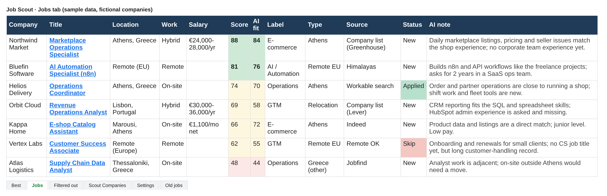

# Job Scout

A small Python tool that runs every weekday morning on GitHub Actions, reads free public job
feeds, removes the ads that can't work for one candidate, rates the rest from 0 to 100 (rules
plus an optional AI check), and writes the result to a Google Sheet. No server and no paid
services: GitHub Actions, the Google Sheets API and the Gemini free tier.

I built it for my own job search in Greece (Athens, remote from Greece, or relocation in the
EU), so the defaults lean that way. Everything about the search lives in a settings list and a
plain-text profile, so it can be pointed at another person or market.



*The Jobs tab with sample data (fictional companies). Real runs write a few hundred rows a day.*

## What it does

```
 job boards + company ATS feeds ──► screen (deal-breakers) ──► rate (rules) ──► AI fit (Gemini) ──► Google Sheet
                                         │                                                          │
                                         └──► "Filtered out" tab with the reason          Jobs / Best / Old jobs
```

1. **Collect** (`scout/sources.py`, `scout/ats.py`)
   - Job boards: Workable public search, Himalayas, Jobicy, Remotive, Arbeitnow, Remote OK,
     We Work Remotely, RemoteJobs.org, Jobfind.gr (RSS) and Indeed (through the open-source
     JobSpy library; if it breaks, the run goes on without it).
   - Company feeds: the **Scout Companies** tab holds a list of companies. A weekly job
     (`scout/detect.py`) finds which hiring system each one uses (Greenhouse, Lever, Ashby,
     Workable, SmartRecruiters, Personio, Recruitee, Teamtailor, Workday) and its board ID, so
     the daily run can read their open jobs directly.
2. **Screen** (`scout/screen.py`): removes only clear deal-breakers: a location that can't work,
   a title clearly from another field, another required language, commission-only or
   cold-calling sales, phone-heavy support. A required degree can remove a job or just flag it.
   Every removed job goes to the **Filtered out** tab with its reason, so nothing disappears
   silently. Matching ignores Greek accents and capitals.
3. **Rate** (`scout/rate.py`): points for role family, location type, tools, seniority and
   freshness, plus a "Why this score" column. The rating only sorts; it never hides a job.
4. **AI check** (`scout/ai.py`, optional): Gemini reads the best-rated ads against the
   candidate profile (`data/profile.txt`) and returns structured facts (level, years asked,
   degree, pay type, field) plus a fit number and a one-line note. The code then caps the fit
   from those facts (for example a "head of" role or commission-only pay can't score high), so
   one generous answer can't push a bad match to the top. Low-rated jobs get a cheaper
   titles-only check first. Calls are batched and rate-limited to stay in the free tier. Ads
   are treated as untrusted input in the prompt.
5. **Write** (`scout/sheet.py`): new jobs go on top of the **Jobs** tab, deduplicated against
   jobs already seen and against the Applications tab. A **Best** tab shows the last few days'
   strongest matches. Jobs from company feeds that disappear are marked Closed, and old rows
   move to **Old jobs** after 30 days.

Keywords, points and limits are in `scout/settings.py`. On the first run they are copied to a
**Settings** tab in the sheet, and from then on the sheet wins, so the search can be tuned
without touching code.

### Apps Script helper (`apps_script/Code.gs`)

Pasted into the spreadsheet's Apps Script editor, it:
- adds a job to the Applications tab when its Status is set to Applied,
- sets an application to Rejected when a rejection date is typed,
- emails a short morning summary of the new jobs,
- starts the GitHub workflow as a backup if GitHub's scheduler skipped the morning run.

## Setup

1. Fork or copy this repository.
2. Create a Google Cloud service account, download its JSON key, and share your spreadsheet
   with the service account's email address as Editor.
3. Add repository secrets (Settings > Secrets and variables > Actions):
   - `SHEET_ID`: the spreadsheet ID (the long part of its URL)
   - `GOOGLE_SERVICE_ACCOUNT_JSON`: the full contents of the JSON key
   - `GEMINI_API_KEY` (optional): turns on the AI check
4. Replace `data/profile.txt` with your own CV facts and wishes (the file in this repo is a
   fictional example), and `data/extra_companies.csv` with the companies you want followed.
5. Run **Actions > Job Scout > Run workflow** once. The tabs are created on the first run.

Nothing secret is stored in the repository: the sheet ID and keys are only GitHub secrets.

## Running

- Automatically: Monday to Friday at 06:37 Athens time (`.github/workflows/scout.yml`).
- By hand: Actions > Job Scout > Run workflow. Tick "Dry run" to get the results as CSV files
  without touching the sheet, or "rerate" to ask the AI again about every job still New.
- Locally: `pip install -r requirements.txt && python -m scout.run --dry-run`
  (writes `out/jobs.csv` and `out/filtered.csv`).

## Tests

```
pip install pytest
python -m pytest -q
```

## More than one person (profiles)

`profiles/<name>/` holds another person's search: `settings.json` (changes to the default
settings), `profile.txt` (their evidence for the AI), `prompt.txt` and `title_prompt.txt` (their
own AI prompts) and `companies.csv`. A run with `SCOUT_PROFILE=<name>` uses those files and
writes to that person's own sheet. `profiles/example-hr/` is a fictional HR candidate who only
wants HR jobs in Athens or remote. Copy `scout.yml`, set `SCOUT_PROFILE` and point `SHEET_ID`
at their sheet.

## Project layout

```
scout/
  run.py        collect -> screen -> rate -> AI -> write
  sources.py    job boards
  ats.py        company ATS feeds and ATS detection
  detect.py     weekly company feed detection
  screen.py     deal-breaker rules and location buckets
  rate.py       rule-based score
  ai.py         Gemini fit check (batched, capped)
  sheet.py      Google Sheets tabs, formatting and housekeeping
  settings.py   default settings (overridden by the Settings tab)
  profile.py    profile selection
apps_script/    Google Apps Script helper for the sheet
data/           example candidate profile and company list
profiles/       extra people (example-hr)
tests/          pytest suite
```

## Built with

Python, gspread, requests, JobSpy, Google Gemini API, Google Apps Script, GitHub Actions.
Written with AI coding assistants (Claude), reviewed and directed by me.
